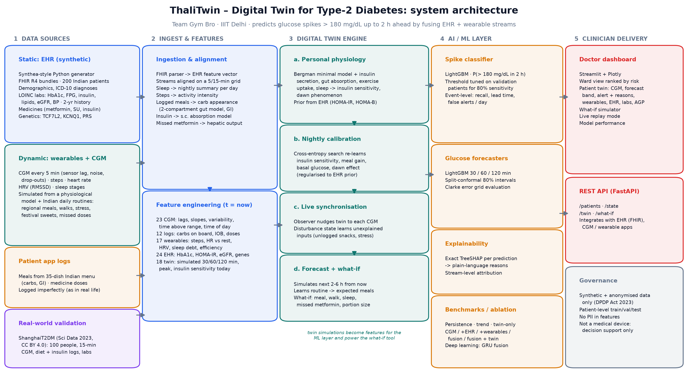
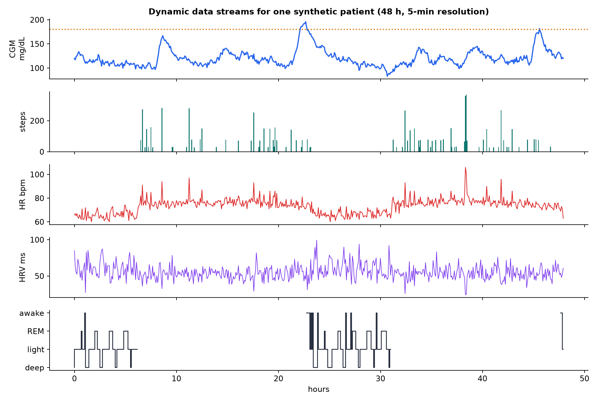
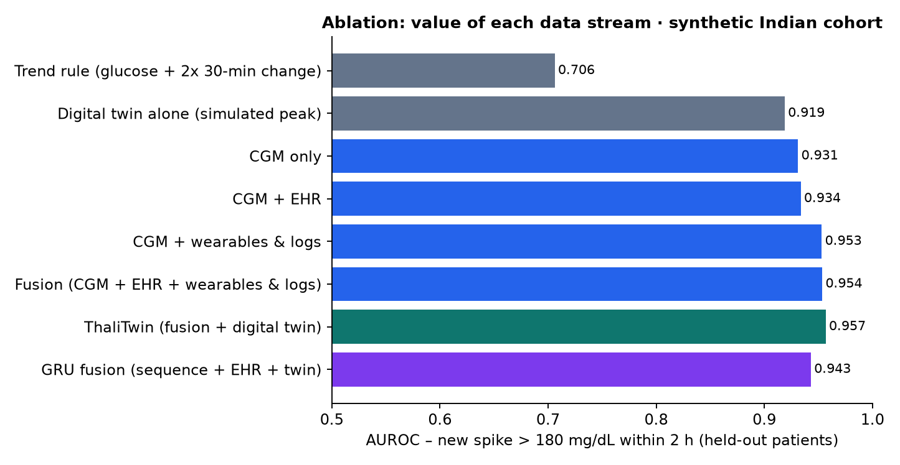
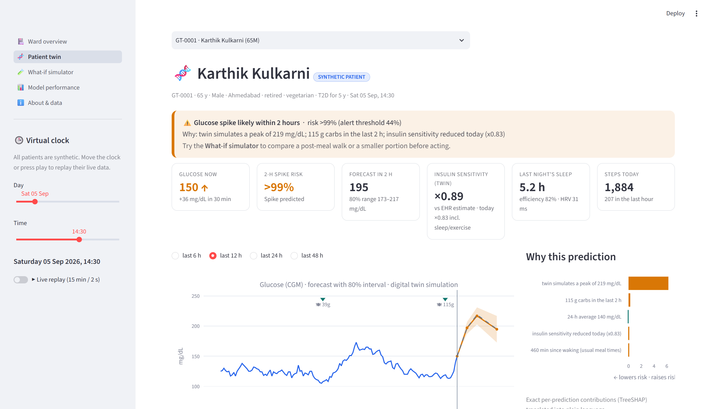

# ThaliTwin: a digital twin that sees type-2 diabetes glucose spikes coming

**Digital Twin Challenge 2026 · Happiest Health "Reimagining and Reforming Healthcare in India" Summit, Bengaluru**

ThaliTwin is a proof-of-concept **digital twin for people with type-2 diabetes (T2D)**. It fuses a patient's **electronic health record** with **real-time wearable streams** (continuous glucose monitor, steps, heart rate, HRV, sleep). It then:

- **predicts glucose spikes above 180 mg/dL up to 2 hours before they happen**
- **explains why** each alert fired
- **lets a doctor test "what if"** changes (meal, walk, sleep, missed metformin) on the virtual patient before advising the real one

**Why "ThaliTwin"?** A *thali* is the everyday Indian plate. Most post-meal spikes start there: rice, roti, dal, sweet chai. ThaliTwin is a twin that knows what is on the patient's plate (35 regional dishes with carbs and glycaemic index) and simulates what it will do to their glucose.



---

## 1. Team details

| | |
|---|---|
| **Team name** | Gym Bro |
| **College** | Indraprastha Institute of Information Technology Delhi (IIIT Delhi) |
| **Incubator** | *TODO: add incubator name if the team registered through one; otherwise write "Not applicable"* |
| **Team members** | Nakul Grover (team leader), IIIT Delhi |
| **Folder / repository name** | `GymBro_IIITDelhi` (Team Name_College Name) |

## 2. Project title

**ThaliTwin: an EHR + wearable digital twin for 2-hour-ahead glucose-spike prediction in Indian type-2 diabetes**

## 3. Problem statement and healthcare use case

India has about **101 million adults with diabetes and 136 million with prediabetes** (ICMR-INDIAB, *Lancet Diabetes Endocrinol* 2023). Care is still built around an HbA1c test every few months: a 3-month average that hides the daily post-meal spikes driven by high-GI rice and roti, sweet chai, late dinners, poor sleep and inactivity. Continuous glucose monitors (CGMs) now produce 288 readings a day, but no clinician can watch hundreds of traces.

**Use case: remote monitoring by a care team** (endocrinologist, physician or diabetes educator) for T2D patients who wear a CGM and a smartwatch.

| Step | What ThaliTwin does |
|---|---|
| **Predict** | Every 5 minutes: probability of a **new spike above 180 mg/dL within 2 h**, plus 30/60/120-min glucose forecasts with 80% prediction intervals |
| **Explain** | Each alert lists its drivers in plain language (e.g. "115 g carbs in the last 2 h", "short sleep last night", "twin learned low insulin sensitivity") from exact TreeSHAP values |
| **Act** | A what-if simulator asks the patient's own calibrated twin: half portion? millet instead of rice? a 15-min walk after eating? |
| **Prioritise** | A ward view ranks all monitored patients by risk, so the team looks at the right person first |

ThaliTwin is **decision support, not automated dosing**.

## 4. What makes it a *digital twin* (not just a predictor)

Each patient has a **personal, continuously updated physiological model** (`thalitwin/twin/`):

1. **Prior from the EHR.** Fasting glucose and insulin (HOMA-IR / HOMA-B), weight, HbA1c, sulfonylurea use and TCF7L2 genotype initialise an extended Bergman minimal model. The model includes insulin secretion, two-compartment gut absorption by glycaemic index, insulin-independent exercise uptake (with a 30-min after-effect), raised insulin sensitivity after exercise, lower insulin sensitivity after short sleep, and the dawn phenomenon.
2. **Nightly calibration.** A cross-entropy search re-learns the patient's insulin sensitivity, meal response, basal glucose and dawn effect from yesterday's CGM, regularised towards the EHR prior.
3. **Live synchronisation.** An observer nudges the twin to every CGM reading, and a *disturbance state* learns inputs the twin cannot explain (unlogged snacks, stress hormones).
4. **Forecast and what-if.** From the synchronised state, the twin simulates the next hours. It uses what was eaten and dosed, the patient's **learned routine** (usual meal times and sizes), or any change a doctor proposes.

The twin's simulations become features for the ML layer, and the same engine drives the what-if tool.

## 5. Data (sandbox rules: synthetic and anonymised only)

| Stream | Source | Content |
|---|---|---|
| **Static: EHR** | Our Synthea-style Python generator, `thalitwin/data/ehr_generator.py` | 200 virtual Indian T2D patients. Demographics, region and diet pattern; ICD-10 diagnoses; LOINC-coded labs with a 2-year history; medicines (metformin, glimepiride, teneligliptin, dapagliflozin, premixed insulin); genetic markers (TCF7L2 rs7903146, KCNQ1 rs2237892, polygenic risk). Exported as CSV and **FHIR R4 bundles** (`data/synthetic/fhir/`) |
| **Dynamic: wearables** | Our physiology-driven simulator, `thalitwin/data/simulator.py` | 14 days per patient at 5-min resolution: CGM (sensor lag, noise, dropouts), steps, heart rate, HRV (RMSSD), sleep stages. Plus app logs: meals from a 35-dish regional Indian menu (carbs, GI) and medicine doses (taken/missed) |
| **Real-world validation** | **ShanghaiT2DM** (Zhao *et al.*, *Scientific Data* 2023, CC BY 4.0) | 100 real, anonymised people with T2D: 15-min CGM, free-text diet logs, insulin doses and a clinical summary |

The cohort is localised for India: Asian BMI cut-offs and the "thin-fat" phenotype, regional breakfasts (idli, poha, paratha), lunch around 13:00, 5 pm chai, late dinners, festival sweets, desk-job stress days and imperfect medicine and meal logging. Details are in [`docs/data_card.md`](docs/data_card.md).



## 6. Technical stack and AI/ML models

| Layer | Technology |
|---|---|
| Language | Python 3.11 |
| Data and simulation | NumPy, pandas, PyArrow; custom vectorised ODE simulator (all patients, candidates or start times in one time loop) |
| Twin calibration | Cross-entropy method (vectorised over patients × 24 candidates), Luenberger-style observer with a disturbance state |
| Spike classifier | **LightGBM** binary classifier. Threshold chosen on validation patients for 80% sensitivity, with a 60-min notification snooze |
| Glucose forecasters | **LightGBM** regressors (30/60/120 min, predicting the change from now) with **split-conformal 80% prediction intervals** |
| Deep-learning comparison | **PyTorch** GRU fusion model (3-h sequence branch + EHR/twin static branch, multi-task) |
| Explainability | **TreeSHAP** (shap / LightGBM `pred_contrib`) mapped to plain-language templates |
| Evaluation | scikit-learn metrics, Clarke error grid, event-level alert metrics, patient-level splits, 5-fold grouped CV on real data |
| Serving | **FastAPI** REST API (`api/main.py`) and a **Streamlit + Plotly** doctor dashboard (`dashboard/`) |
| Docs | Matplotlib figures, PptxGenJS deck, Docker |

**Features (94 per time point):**
- **23 CGM:** lags, slopes, variability, time above range, time of day
- **12 logs:** carbs on board, insulin on board, recent carbs, missed metformin
- **17 wearables:** steps, active minutes, heart rate vs resting, HRV, sleep hours, efficiency, deep/REM %, sleep debt, time since waking
- **24 EHR:** HbA1c, HOMA-IR, eGFR, lipids, BP, medicines, genotypes
- **18 twin:** simulated 30/60/120-min glucose and peak, with or without expected meals, insulin sensitivity today, disturbance

## 7. Results

All numbers are measured on **patients the models never saw**. Full tables: [`docs/results.md`](docs/results.md).

### Synthetic Indian cohort (30 held-out patients, 103,680 time points)

| Metric | ThaliTwin | Best simple baseline |
|---|---|---|
| AUROC, new spike > 180 mg/dL within 2 h | **0.957** | 0.706 (trend rule) |
| Spike events flagged ≥ 15 min ahead | **98.8%** of 804 (median warning **110 min**) | |
| False alerts per patient-day (default / quiet mode) | 2.7 / **1.0** (quiet mode still flags 85% of spikes, median 70 min ahead) | 8.6 (trend rule) |
| Glucose RMSE at 30 / 60 / 120 min (mg/dL) | **8.4 / 13.9 / 21.9** | 16.0 / 27.0 / 39.8 (no-change) |
| Clarke error grid zone A / A+B (60 min) | **96.7% / 99.8%** | 86.1% / 99.1% |
| 80% prediction-interval coverage | 80.1–80.5% | |

**Ablation: does fusion help?** AUROC rises from 0.931 (CGM only) to 0.934 (+EHR), 0.953 (+wearables and logs), 0.954 (all streams) and **0.957 (all streams + twin)**. The twin's physiology alone scores 0.919 with no machine learning. A deep-learning GRU with the same inputs reaches 0.943.



### Real-world validation: ShanghaiT2DM (100 people, 5-fold cross-validation grouped by person)

| Metric | ThaliTwin | Baselines |
|---|---|---|
| AUROC, new spike within 2 h | **0.878** | 0.748 trend rule · 0.813 twin alone |
| Glucose RMSE at 30 / 60 / 120 min (mg/dL) | **12.6 / 22.2 / 31.6** | 17.6 / 29.4 / 43.9 (no-change) |
| Clarke zone A (60 min) | **83.9%** | 76.0% (no-change) |
| Quiet mode | 84% of 1,823 real spike events flagged, 0.9 false alerts/day | |
| 80% interval coverage | 79.6–80.5% | |

**Honest finding.** The pipeline transfers to real, noisy, hospital CGM and clearly beats rule-based and no-change baselines. The synchronised twin alone also beats a no-change forecast at every horizon. However, ShanghaiT2DM has **no wearables** and only free-text diet logs, so on real data the EHR and twin features add little beyond CGM (AUROC 0.872–0.884 across variants). The fusion gains we see on synthetic data still need prospective validation with Indian patients who wear a CGM and a smartwatch.

### Does the twin learn the hidden patient?

In the synthetic cohort every patient has a hidden "true" insulin sensitivity. The EHR alone estimates it with correlation 0.80. With nightly calibration the twin averages **0.88** (median error 19% → 17%). Its basal-glucose estimate does **not** improve on the EHR value: that parameter absorbs effects the twin does not model, such as stress and drift.

### Explainability

On the synthetic cohort, the twin's simulation carries 57% of the total SHAP importance, followed by CGM history (16%), wearables (15%), logs (6%) and EHR (6%).

## 8. Prototype: the doctor's dashboard

```bash
streamlit run dashboard/app.py
```

| Page | What the doctor sees |
|---|---|
| **Ward overview** | All monitored patients ranked by 2-h spike risk, with glucose, trend arrow, 2-h forecast, HbA1c, time-in-range and the main driver |
| **Patient twin** | Alert banner with reasons; CGM with the ThaliTwin forecast, 80% band and twin simulation; meal and dose markers (missed doses in red); risk strip; steps, heart rate, HRV and sleep; SHAP reasons; the twin's learned physiology over days; EHR with ICD-10, medicines, genetics and LOINC labs; HbA1c trend; 7-day glucose profile; time in ranges |
| **What-if simulator** | Pick an Indian dish, portion, timing, a post-meal walk, last night's sleep or a skipped metformin dose; the patient's twin compares futures and proposes the best alternative |
| **Model performance** | Ablation, forecast error, SHAP by stream, Clarke grid, alert-burden curve and full tables for both cohorts |
| **Live replay** | Sidebar toggle that streams the virtual patients' data forward in time, as if from real devices |



**REST API:** `uvicorn api.main:app` (interactive docs at `/docs`). Endpoints: `GET /patients`, `GET /patients/{id}`, `GET /patients/{id}/state`, `GET /patients/{id}/twin`, `POST /patients/{id}/what-if`, `GET /meals`.

## 9. Submission materials

| Required item | Where |
|---|---|
| Video (20+ min) | **TODO: paste the unlisted YouTube link here.** Recording guide: [`docs/video_script.md`](docs/video_script.md) |
| Architecture diagram (PDF) | [`docs/architecture.pdf`](docs/architecture.pdf) |
| Presentation (PPT + PDF) | [`docs/ThaliTwin_Presentation.pptx`](docs/ThaliTwin_Presentation.pptx) · [`docs/ThaliTwin_Presentation.pdf`](docs/ThaliTwin_Presentation.pdf) (speaker notes included) |
| Open-source licence | [MIT](LICENSE). ShanghaiT2DM data is CC BY 4.0 (attribution in [LICENSE](LICENSE)) |
| Data card / model card / full results | [`docs/data_card.md`](docs/data_card.md) · [`docs/model_card.md`](docs/model_card.md) · [`docs/results.md`](docs/results.md) |

## 10. How to run

```bash
python -m venv .venv
# Windows: .venv\Scripts\activate    macOS/Linux: source .venv/bin/activate
pip install -r requirements.txt
pip install torch --index-url https://download.pytorch.org/whl/cpu   # optional, for the GRU comparison

# The repository ships trained models and a dashboard package, so this works immediately:
streamlit run dashboard/app.py

# Rebuild everything from scratch (download real data -> simulate -> twin -> train -> figures), ~30 min on a laptop:
python run_all.py            # or: python run_all.py --fast  (skips the GRU)

# Tests
pytest -q
```

Docker: `docker build -t thalitwin .` then `docker run -p 8501:8501 thalitwin`.

## 11. Repository structure

```
GymBro_IIITDelhi/
├── thalitwin/                  core package
│   ├── data/                   ehr_generator (FHIR), simulator (lifestyle + sensors), meals (Indian menu), shanghai loader
│   ├── twin/                   physiology (ODE model), inputs (observed streams), engine (calibrate, sync, forecast, what-if)
│   ├── models/                 gbm, gru, metrics (Clarke, event-level), explain (SHAP -> text), experiment (training + evaluation)
│   ├── features.py             leakage-safe features + labels
│   ├── pipeline.py             dataset builders for both cohorts
│   └── inference.py            runtime service shared by the API and dashboard
├── api/main.py                 FastAPI service
├── dashboard/                  Streamlit app (ward, patient twin, what-if, performance, about)
├── scripts/                    download_shanghai, build_datasets, train_evaluate, export_dashboard, make_figures, write_reports
├── data/synthetic/             generated EHR (CSV + FHIR), streams, events, splits
├── artifacts/                  trained models, results tables, dashboard package
├── docs/                       architecture.pdf, deck (.pptx/.pdf), video script, data/model cards, results, figures
├── tests/                      physiology, leakage, metrics and API tests
└── run_all.py                  one-command rebuild
```

## 12. Responsible AI, privacy and limitations

- **Privacy.** Only synthetic or published anonymised data is used, with no identifiers. The design follows DPDP Act 2023 principles (purpose limitation, data minimisation).
- **Safety.** Decision support for clinicians only. Every forecast carries a calibrated interval, and every alert carries its reasons.
- **Limitations.**
  - Wearable–glucose effects in the synthetic cohort come from published effect sizes, and the twin shares the simulator's model structure, so synthetic results are an upper bound.
  - The real-data track has no wearables, and its carbs are estimated from free text.
  - ThaliTwin is **not a medical device** and needs prospective, ethics-approved validation in Indian clinics before any clinical use.
- **Next steps:**
  - pilot with CGM and smartwatch users
  - ABDM/FHIR integration and Libre/Health Connect ingestion
  - federated learning across hospitals
  - hypertension and cardiovascular twins on the same engine

## 13. References

- Anjana R.M. *et al.* Metabolic non-communicable disease health report of India: the ICMR-INDIAB national cross-sectional study. *Lancet Diabetes Endocrinol* 2023.
- Zhao Q. *et al.* Chinese diabetes datasets for data-driven machine learning. *Scientific Data* 10, 35 (2023).
- Bergman R.N. *et al.* Quantitative estimation of insulin sensitivity. *Am J Physiol* 1979.
- Matthews D.R. *et al.* Homeostasis model assessment (HOMA). *Diabetologia* 1985.
- Battelino T. *et al.* Clinical targets for CGM data interpretation: international consensus on time in range. *Diabetes Care* 2019.
- Clarke W.L. *et al.* Evaluating clinical accuracy of systems for self-monitoring of blood glucose. *Diabetes Care* 1987.
- Donga E. *et al.* A single night of partial sleep deprivation induces insulin resistance. *J Clin Endocrinol Metab* 2010.
- Reynolds A.N. *et al.* Advice to walk after meals is more effective for lowering postprandial glycaemia in type 2 diabetes. *Diabetologia* 2016.
- Lundberg S.M. *et al.* From local explanations to global understanding with explainable AI for trees. *Nat Mach Intell* 2020.
- Angelopoulos A.N. and Bates S. A gentle introduction to conformal prediction. 2021.
